# PLIEGO — Prototipo funcional de alta fidelidad

**Asignatura:** RDA2 · Criterio 1 · Reto 5
**Proyecto:** PLIEGO, librería en línea (proyecto académico)
**Fecha del informe:** 2 de noviembre de 2026

---

## 1. Introducción y objetivo del prototipo

PLIEGO es un prototipo académico de comercio electrónico para la venta de libros impresos, eBooks y audiolibros. Se desarrolló como proyecto estudiantil con el fin de llevar un diseño de interfaz hasta un prototipo funcional: las pantallas no son maquetas estáticas, sino vistas de una aplicación web que consulta y guarda información real en una base de datos.

El objetivo del prototipo es demostrar un recorrido de compra completo y coherente:

1. descubrir libros (inicio, catálogo, búsqueda, ofertas);
2. consultar el detalle de una edición;
3. crear una cuenta o iniciar sesión;
4. gestionar un carrito y finalizar una compra **simulada** (no se realiza ningún cobro real);
5. revisar los pedidos, la factura y los libros digitales adquiridos.

El proyecto no es un servicio comercial. Los pagos son simulados y el catálogo se utiliza con fines de demostración.

**Tecnologías, en breve.** La interfaz está construida con React y TypeScript; los datos se obtienen de una API REST propia (Java/Spring Boot) que trabaja sobre PostgreSQL.

---

## 2. Enlace de acceso a PLIEGO

| | |
|---|---|
| **URL pública** | <https://pliegolibros.com> |
| **Comprobación** | El 2 de noviembre de 2026 la URL respondió con código HTTP 200 y se navegó por sus páginas públicas para obtener las capturas de este informe. |
| **Acceso con cuenta** | Las funciones de carrito, compra, pedidos y cuenta requieren iniciar sesión. Para no usar datos de clientes reales, esas pantallas se capturaron en un entorno local que ejecuta la misma aplicación, con una cuenta ficticia (ver sección 4). |

---

## 3. Diagrama de flujo de usuario

El flujo se dibujó a partir del comportamiento real de la aplicación (rutas definidas en `frontend/src/app/App.tsx` y recorridos ejecutados en el navegador). Para que sea legible se divide en dos partes. Los rombos son decisiones del usuario o del sistema, los rectángulos son pantallas o acciones.

### 3.1 Descubrimiento y acceso

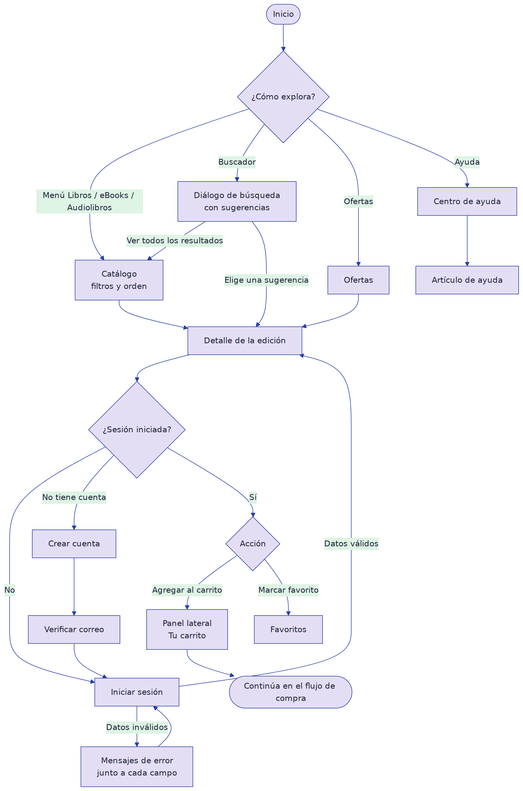

*Figura 1. Desde el inicio, el usuario llega al detalle de una edición por el menú, el buscador o las ofertas. Para agregar al carrito o marcar favoritos necesita una sesión iniciada.*

### 3.2 Compra y posventa

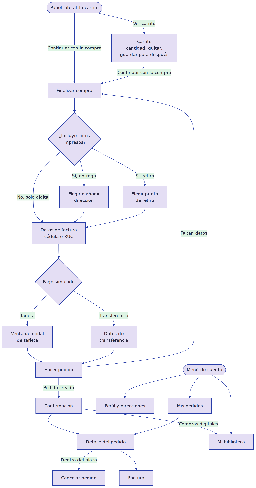

*Figura 2. La compra se ajusta al contenido del carrito: solo pide entrega o punto de retiro si hay libros impresos. Si faltan datos, el usuario vuelve al formulario con los errores señalados.*

Código fuente Mermaid (también disponible en <code>flujo-1-descubrimiento.mmd</code> y <code>flujo-2-compra.mmd</code>)

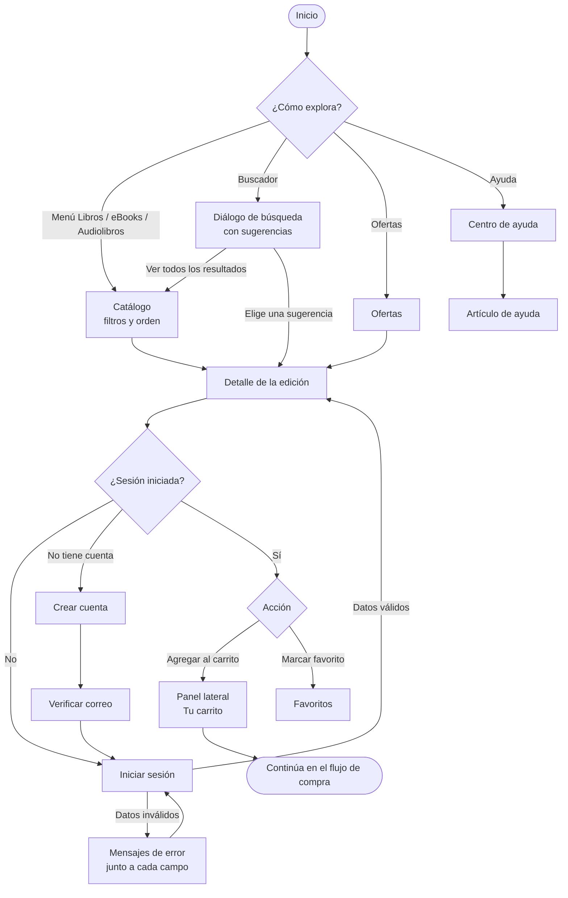

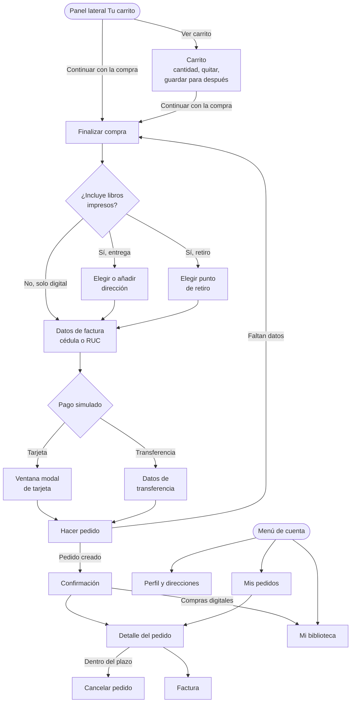

---

## 4. Pantallas finales de alta fidelidad

### 4.1 Aclaración sobre «páginas HTML»

PLIEGO es una **aplicación de página única (SPA)**. El servidor entrega **un solo documento HTML** (`index.html`) y React Router muestra cada pantalla según la URL. Se comprobó que `/`, `/catalog`, `/ofertas`, `/ayuda`, `/cart` y una ruta inexistente devuelven exactamente el mismo documento.

Por eso, en este informe las «páginas» son **rutas que se pueden abrir de forma independiente**: cada una tiene su propia URL, puede guardarse como marcador o recargarse, cambia el título de la pestaña y funciona con los botones atrás y adelante del navegador. **No son archivos HTML separados.** Si la rúbrica exige literalmente ocho archivos `.html`, el proyecto no cumple esa condición al pie de la letra, y así se indica.

La aplicación define 29 rutas navegables, sin contar la página de error. Las que se documentan aquí son:

| # | Pantalla | Ruta | Acceso | Origen de la captura |
|---|---|---|---|---|
| 1 | Inicio | `/` | Público | Producción |
| 2 | Catálogo y búsqueda | `/catalog` | Público | Producción |
| 3 | Detalle de edición | `/catalog/editions/:id` | Público | Producción / local |
| 4 | Ofertas | `/ofertas` | Público | Producción |
| 5 | Ayuda y artículo | `/ayuda`, `/ayuda/:slug` | Público | Producción |
| 6 | Iniciar sesión y crear cuenta | `/sign-in`, `/register` | Público | Producción |
| 7 | Carrito | `/cart` | Cliente | Local |
| 8 | Finalizar compra | `/checkout` | Cliente | Local |
| 9 | Confirmación y detalle del pedido | `/orders/:id` | Cliente | Local |
| 10 | Mis pedidos | `/orders` | Cliente | Local |
| 11 | Mi perfil | `/account` | Cliente | Local |
| 12 | Favoritos | `/favorites` | Cliente | Local |
| 13 | Mi biblioteca | `/biblioteca` | Cliente | Local |

**Cómo se obtuvieron las capturas.** Todas son capturas reales tomadas con un navegador automatizado (Playwright/Chromium), a 1440 × 900 px en escritorio y a 390 px de ancho en móvil:

- **Pantallas públicas:** tomadas en <https://pliegolibros.com>, solo navegando, sin modificar datos.
- **Pantallas con sesión:** tomadas en un entorno local con la misma aplicación y una cuenta ficticia («Lectora Demostración», `lectora.demo@example.com`). En ese entorno se hizo un pedido simulado con una tarjeta de prueba y una cédula ficticia. No aparecen datos de clientes reales. Se descartó a propósito una captura del pago por transferencia porque mostraba datos bancarios configurados en el sistema.

### 4.2 Inicio (`/`)

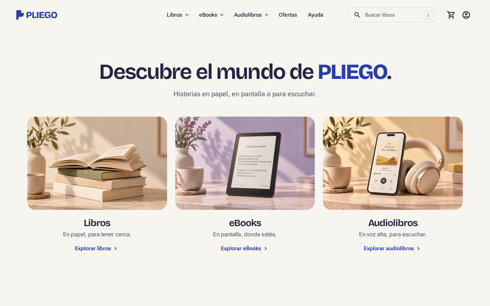

*Figura 3. Inicio. El encabezado (logotipo, menú, buscador, carrito y cuenta) se repite en toda la tienda. Debajo hay tres entradas al catálogo: Libros, eBooks y Audiolibros.*

**Propósito:** presentar la tienda y llevar al usuario al tipo de libro que busca.
**Interacciones:** los menús desplegables de Libros, eBooks y Audiolibros muestran títulos destacados y enlaces (Figura 4); el buscador se abre con un clic o con la tecla `/`; el resto de la página (ver `img/01-inicio-completa.png`) incluye títulos populares, ofertas, ayuda y el pie de página.

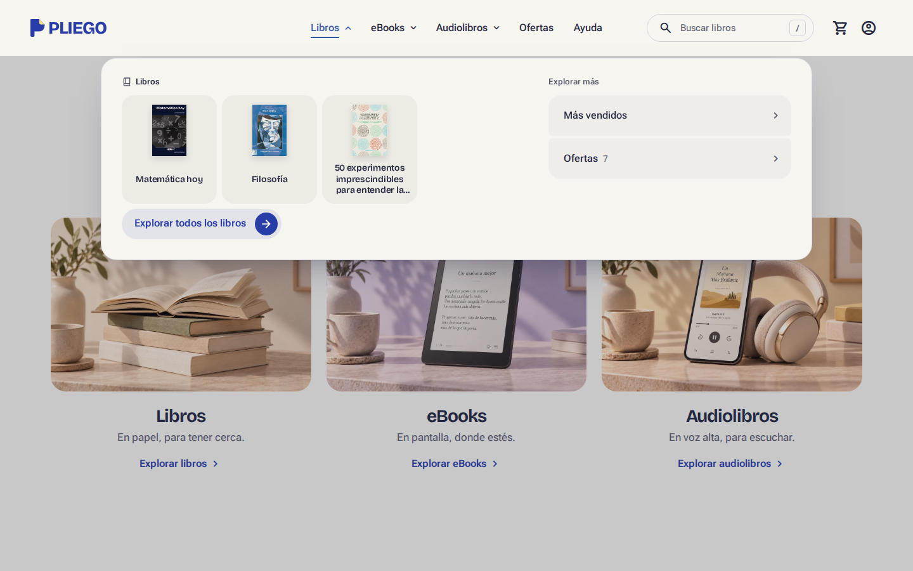

*Figura 4. Menú desplegable «Libros» con títulos destacados y accesos a más vendidos y ofertas.*

### 4.3 Catálogo y búsqueda (`/catalog`)

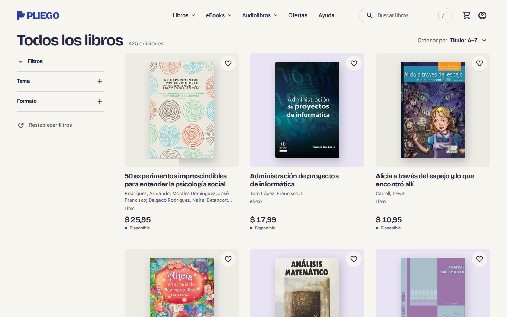

*Figura 5. Catálogo con 425 ediciones. A la izquierda están los filtros (Tema, Formato); arriba a la derecha, el orden. Cada tarjeta muestra la portada, el título, el autor, el formato, el precio y la disponibilidad.*

**Propósito:** explorar y filtrar todas las ediciones.
**Interacciones:** filtrar por tema y formato (Figura 6), restablecer filtros, ordenar, marcar favoritos con el corazón y abrir el detalle. Los criterios se guardan en la URL (por ejemplo `/catalog?que=Alicia`), así que una búsqueda puede compartirse o recargarse.

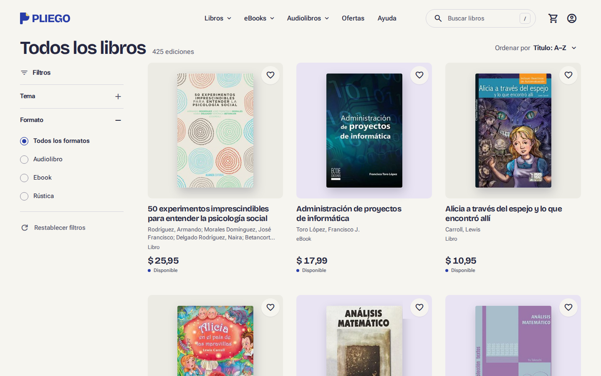

*Figura 6. Filtro «Formato» desplegado: todos los formatos, audiolibro, eBook o libro impreso.*

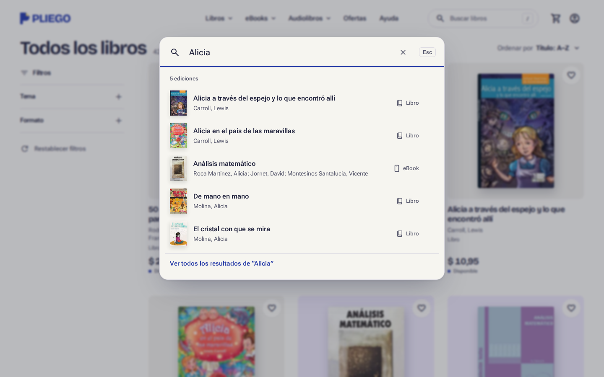

*Figura 7. Al escribir aparecen sugerencias con portada, autor y formato. «Ver todos los resultados» lleva al catálogo filtrado (`img/02-catalogo-busqueda.png`, «Resultados para «Alicia»»).*

### 4.4 Detalle de la edición (`/catalog/editions/:id`)

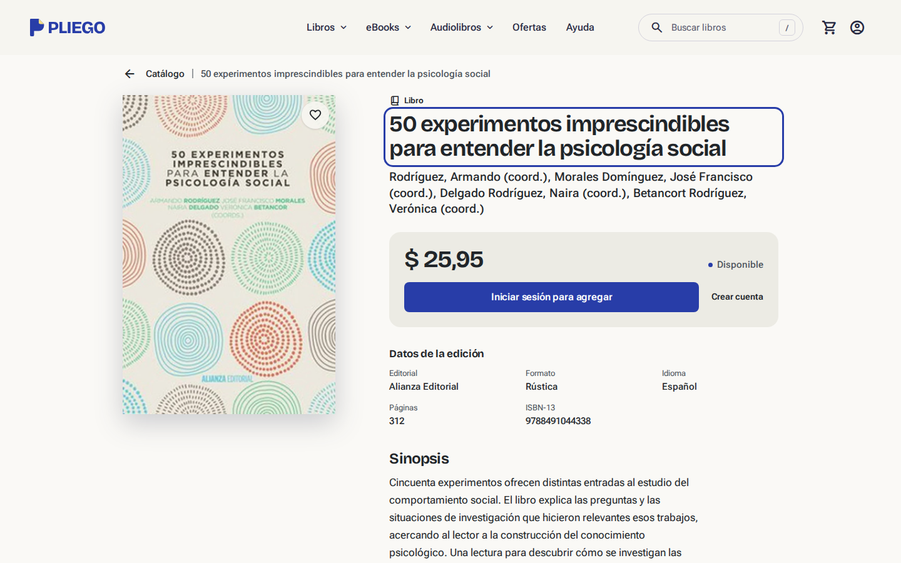

*Figura 8. Detalle de una edición visto por un visitante. Muestra el precio, la disponibilidad, los datos de la edición y la sinopsis. En lugar de «Agregar», el botón invita a iniciar sesión o crear una cuenta.*

**Propósito:** dar la información necesaria para decidir la compra.
**Interacciones:** volver al catálogo con la ruta de navegación, marcar favorito (sin sesión, este botón lleva a iniciar sesión y después regresa a la página de origen), elegir la cantidad (en libros impresos) y agregar al carrito. Al agregar se abre un panel lateral que confirma la acción y muestra el resumen (Figura 9).

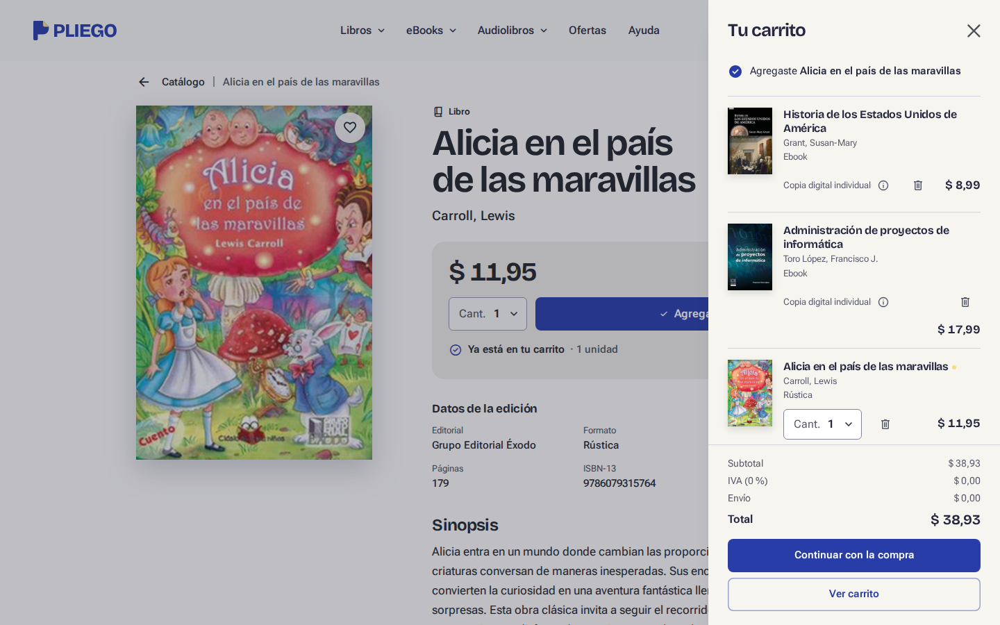

*Figura 9. Con sesión iniciada: el panel «Tu carrito» confirma «Agregaste…», muestra los artículos y los totales, y ofrece «Continuar con la compra» o «Ver carrito». En la página se lee «Ya está en tu carrito · 1 unidad».*

### 4.5 Ofertas (`/ofertas`)

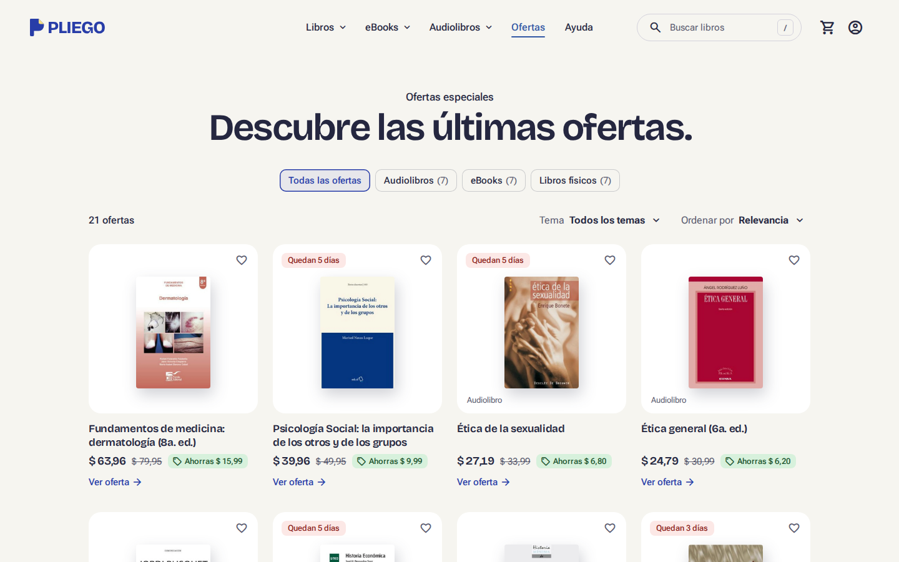

*Figura 10. Ofertas agrupadas por formato con contadores y filtros de tema y orden. Cada tarjeta muestra el precio rebajado, el precio anterior tachado, el ahorro y, si corresponde, los días que quedan.*

**Propósito:** reunir las ediciones con descuento vigente.
**Interacciones:** filtrar por formato o tema, ordenar y abrir «Ver oferta».

### 4.6 Ayuda (`/ayuda` y `/ayuda/:slug`)

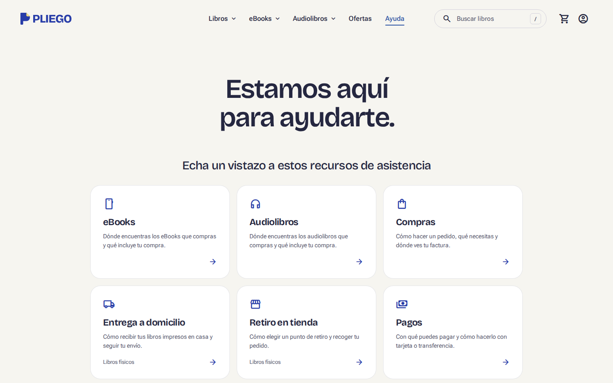

*Figura 11. Centro de ayuda con seis temas (eBooks, Audiolibros, Compras, Entrega a domicilio, Retiro en tienda, Pagos), cada uno con su icono.*

**Propósito:** resolver dudas frecuentes sin salir de la tienda.
**Interacciones:** cada tarjeta abre un artículo con preguntas y respuestas y enlaces a otros temas (`img/05-ayuda-articulo.png`). Los artículos se cargan desde el servidor.

### 4.7 Iniciar sesión y crear cuenta (`/sign-in`, `/register`)

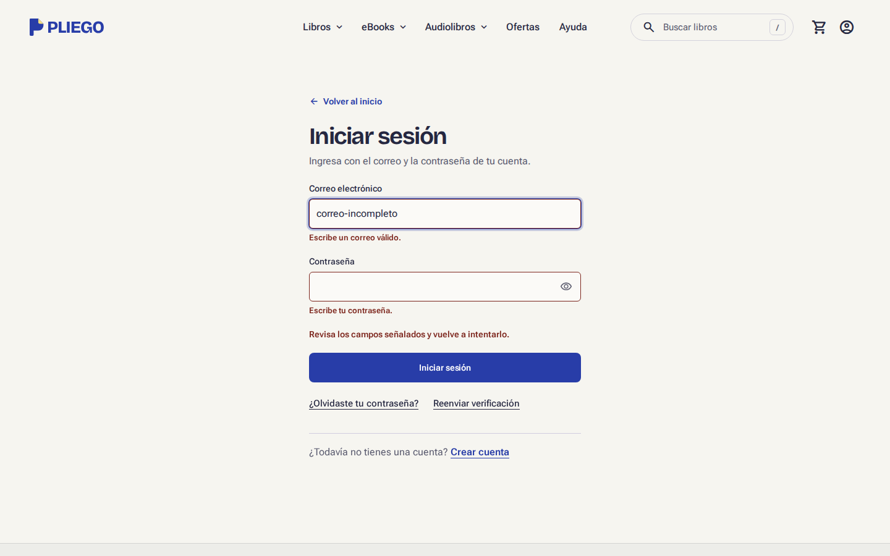

*Figura 12. Formulario de inicio de sesión tras enviarlo con datos incompletos. Cada campo muestra su error en español, aparece un resumen y el foco se coloca en el primer campo con error.*

**Propósito:** identificar al cliente para comprar y conservar su información.
**Interacciones:** mostrar u ocultar la contraseña, recuperar la contraseña, reenviar la verificación e ir al registro. El registro (`img/07-registro.png`) pide nombres, apellidos, correo y contraseña; el teléfono es opcional. La cuenta debe verificarse por correo antes de usarse.

### 4.8 Carrito (`/cart`)

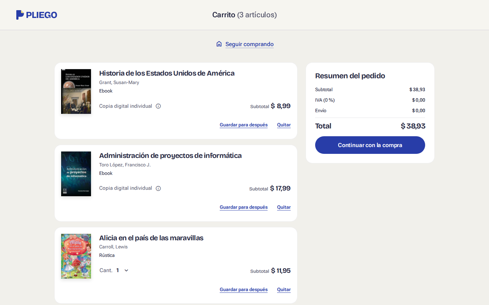

*Figura 13. Carrito con los artículos agregados. Cada línea permite «Guardar para después» o «Quitar». El resumen del pedido muestra el subtotal, el IVA, el envío y el total.*

**Propósito:** revisar lo que se va a comprar antes de pagar.
**Interacciones:** cambiar la cantidad (libros impresos), quitar artículos, guardarlos para después y continuar con la compra. Cuando el carrito está vacío se muestra un mensaje con un acceso al catálogo (`img/m-carrito.png`).

### 4.9 Finalizar compra (`/checkout`)

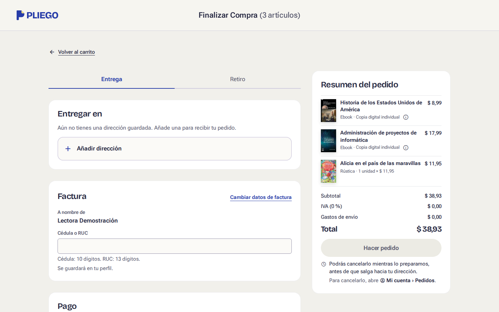

*Figura 14. Formulario de compra. Las pestañas «Entrega» y «Retiro» aparecen porque el carrito incluye un libro impreso. Se completan la factura (cédula o RUC) y el pago, y el resumen permanece visible a la derecha. «Hacer pedido» está deshabilitado hasta que los datos estén completos.*

**Propósito:** reunir los datos de entrega, factura y pago en una sola pantalla.
**Interacciones:** elegir entre entrega a domicilio o retiro en un punto (`img/10-checkout-retiro.png`); la cédula o el RUC se validan mientras se escriben («Cédula válida»); se elige la provincia y luego la ciudad; el pago con tarjeta se completa en una ventana modal (Figura 15). El pago es **simulado**.

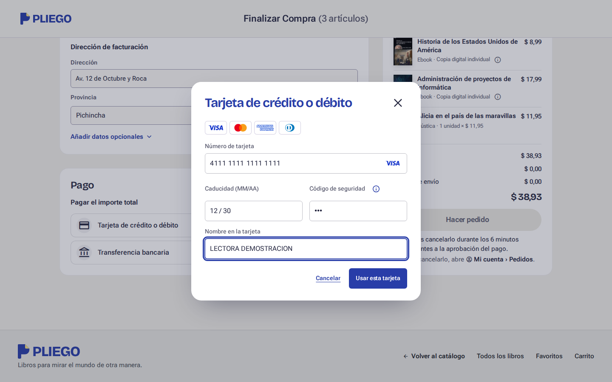

*Figura 15. Ventana modal de tarjeta con una tarjeta de prueba. Se reconoce la marca del número y se piden la caducidad, el código de seguridad y el nombre.*

### 4.10 Confirmación y detalle del pedido (`/orders/:id`)

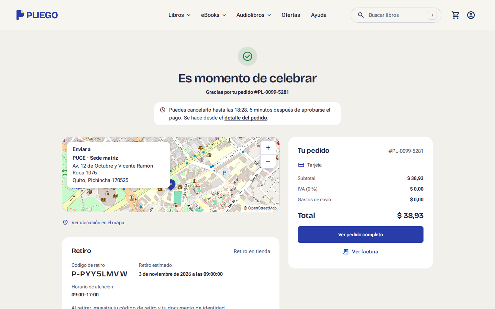

*Figura 16. Confirmación con el número de pedido, el plazo para cancelarlo, el punto de retiro en un mapa, el código de retiro y los accesos a «Ver pedido completo» y «Ver factura».*

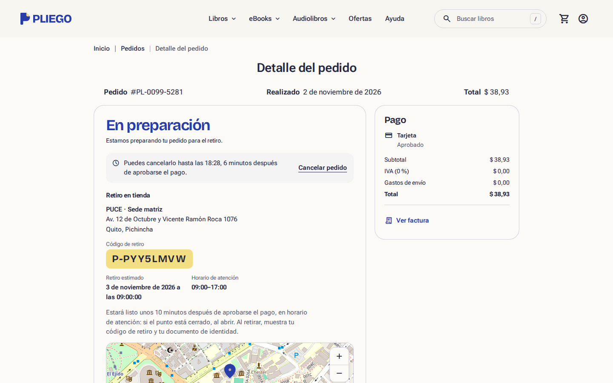

*Figura 17. Detalle del pedido: estado («En preparación»), opción «Cancelar pedido» mientras el plazo está abierto, datos del retiro y resumen del pago.*

**Propósito:** confirmar que la compra se registró y permitir su seguimiento.
**Interacciones:** cancelar dentro del plazo indicado, ver la factura y abrir la ubicación en el mapa.

### 4.11 Mis pedidos (`/orders`)

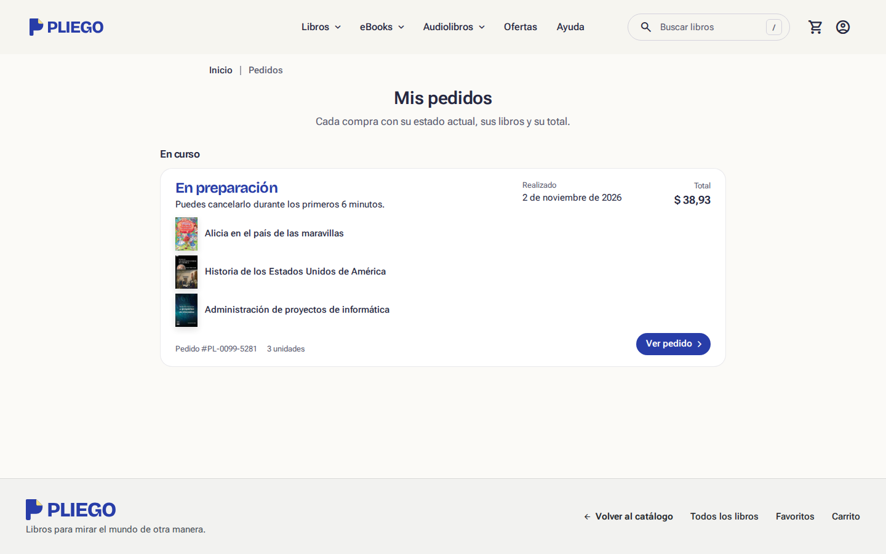

*Figura 18. Historial de pedidos agrupado por estado, con la fecha, los libros, el total y el acceso al detalle.*

### 4.12 Mi perfil (`/account`)

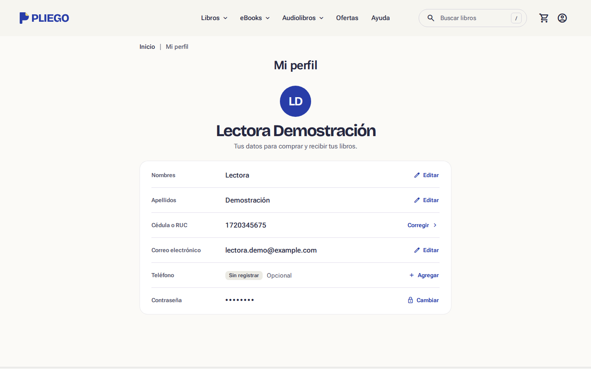

*Figura 19. Perfil de la cuenta ficticia. Cada dato tiene su propia acción (Editar, Corregir, Agregar, Cambiar). Las direcciones se gestionan en `/account/addresses` (`img/14-direcciones.png`).*

### 4.13 Favoritos (`/favorites`)

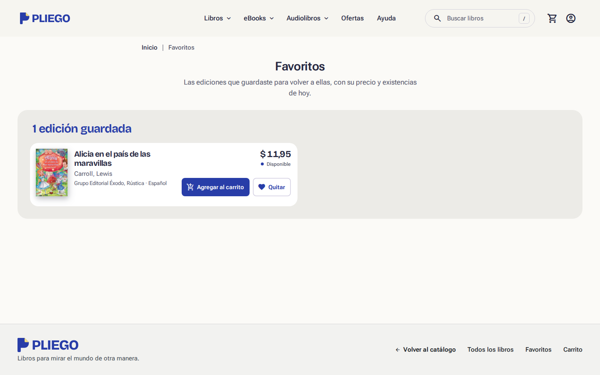

*Figura 20. Ediciones guardadas como favoritas, con su precio y disponibilidad actuales y las acciones «Agregar al carrito» y «Quitar».*

### 4.14 Mi biblioteca (`/biblioteca`)

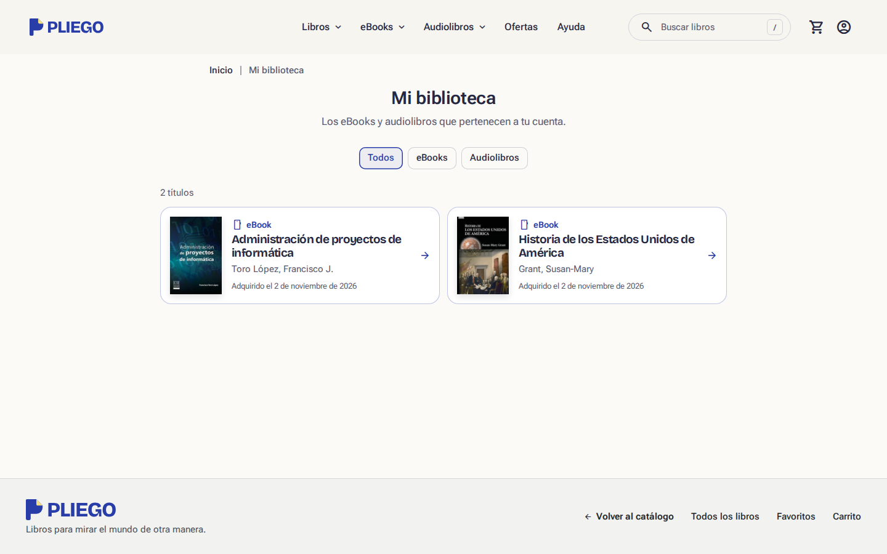

*Figura 21. eBooks y audiolibros de la cuenta, que aparecen después de comprarlos. Se pueden filtrar por tipo y cada título tiene su propia página (`img/16-biblioteca-item.png`).*

### 4.15 Vistas móviles

| Inicio | Catálogo | Menú de navegación |
|---|---|---|
| 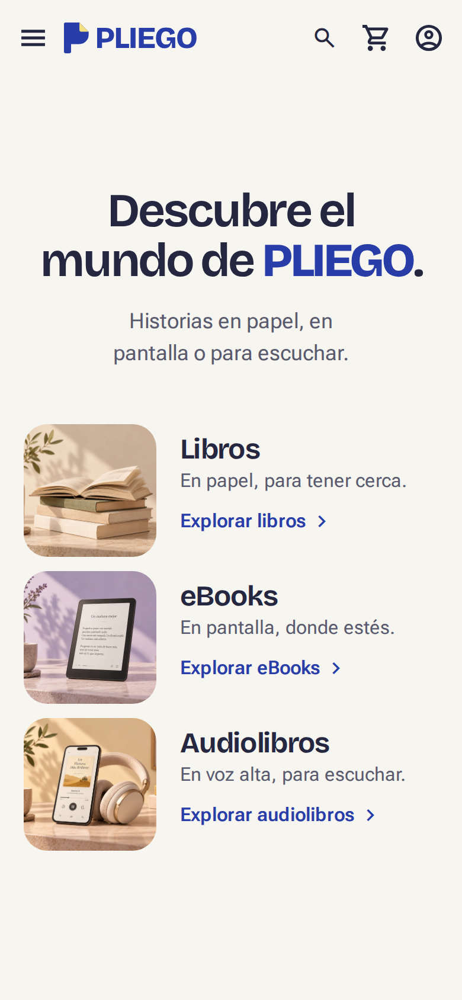 | 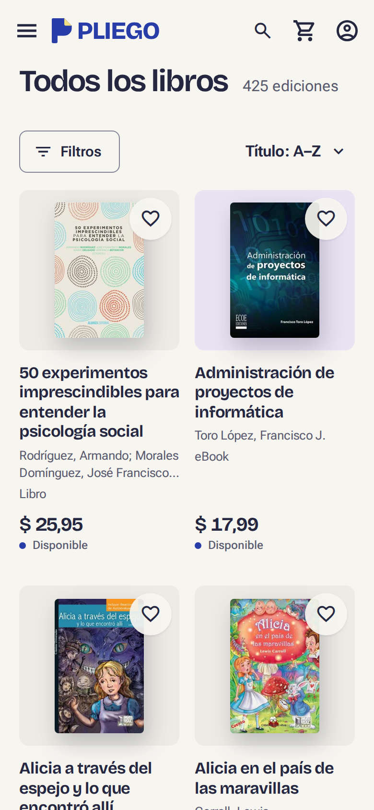 | 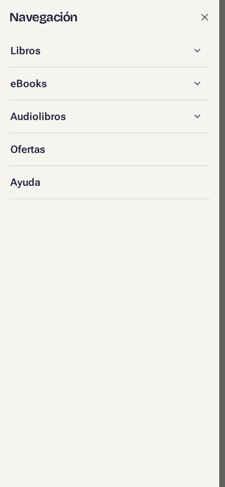 |

*Figura 22. Vistas a 390 px de ancho. El menú pasa a un panel lateral, el buscador se reduce a un icono, el catálogo usa dos columnas y los filtros se abren con un botón. El detalle móvil está en `img/m-detalle.png`.*

También existe una página de error para rutas inexistentes («No encontramos esta página», `img/08-no-encontrada.png`) y un área de administración restringida (retiros en tienda y correcciones de identificación). Esta última no se documenta en el informe.

---

## 5. Coherencia visual y principios de diseño

El sistema visual está documentado en `docs/design/PLIEGO_FRONTEND_DESIGN_LANGUAGE.md` y se aplica mediante variables CSS compartidas.

| Elemento | Decisión aplicada |
|---|---|
| **Tipografía** | *Bricolage Grotesque* para titulares, títulos de libros y precios destacados; *Roboto Flex* para el texto, las etiquetas y los controles. Las dos se sirven desde el propio proyecto. |
| **Color** | Fondo «papel» cálido `#f6f5f0`; azul ultramar `#283da8` como color de marca (logotipo, botones principales, selección); tinta `#252740` para el texto; amarillo `#f3df83` como acento puntual; lavanda `#e4def4` como apoyo (por ejemplo, el fondo de portada de los eBooks). |
| **Iconografía** | Un único conjunto, *Material Symbols Outlined*, con un subconjunto limitado de iconos (búsqueda, carrito, cuenta, formatos, pago, entrega). |
| **Imágenes** | Portadas reales de las ediciones como elemento principal y tres fotografías en el inicio para los formatos. No se usan imágenes decorativas sin función. |
| **Componentes** | Encabezado, tarjeta de libro, botones, chips de filtro, paneles laterales y ventanas modales se reutilizan en todas las pantallas. Están basados en la librería Mantine con estilos propios. |
| **Jerarquía** | Se marca con el tamaño de letra, el espacio y el contraste: un titular grande por página, el precio en negrita y la acción principal como único botón azul relleno. |
| **Alineación y espaciado** | Retícula centrada con márgenes constantes. Los radios de esquina tienen significado: 24 px en paneles, forma de píldora en chips y controles redondos, 8 px en botones. |
| **Consistencia** | El mismo encabezado y pie de página en la tienda; las rutas de navegación («Inicio | Pedidos | …») en las áreas de cuenta; un encabezado simplificado durante la compra para reducir distracciones. Todos los textos de la interfaz están en español. |

La aplicación usa solo el tema claro, aunque el sistema operativo prefiera el oscuro. Así la apariencia es la misma en todos los dispositivos.

---

## 6. Interacciones, navegación e integración de datos

**Navegación.** La navegación entre pantallas ocurre sin recargar la página (SPA), pero cada pantalla tiene su propia URL, su título de pestaña y su lugar en el historial del navegador. Al cambiar de pantalla, el foco pasa al titular principal. Esto ayuda a quien navega con teclado o lector de pantalla (en la Figura 8 se ve el contorno de foco sobre el título).

**Interacciones principales:**

- búsqueda con sugerencias mientras se escribe y atajo de teclado `/`;
- filtros y orden del catálogo que se reflejan en la URL;
- agregar al carrito con confirmación inmediata en un panel lateral;
- carrito con cantidades, «guardar para después» y totales que se recalculan;
- compra que solo pide los datos necesarios según el contenido (entrega o retiro únicamente con libros impresos);
- validación de formularios en el navegador, con mensajes en español junto a cada campo;
- cancelación de un pedido dentro del plazo indicado.

**Datos persistentes.** La interfaz no trabaja con datos de ejemplo escritos en el código. Lee y guarda la información a través de la API REST del proyecto, que la almacena en PostgreSQL. Desde el punto de vista del usuario, esto implica que:

- el catálogo, las ofertas y los artículos de ayuda vienen del servidor;
- la cuenta, las direcciones, los datos de facturación, los favoritos y el carrito quedan guardados: siguen ahí al cerrar el navegador o al entrar desde otro dispositivo;
- al hacer un pedido, el servidor lo registra, genera su número, su factura y su código de retiro, y lo muestra en «Mis pedidos»;
- los eBooks y audiolibros comprados aparecen en «Mi biblioteca».

Cuando el servidor rechaza una operación o no responde, la interfaz muestra un mensaje en español y conserva lo que el usuario ya había escrito.

---

## 7. Diseño responsivo, usabilidad y accesibilidad

### 7.1 Diseño responsivo

La guía de diseño plantea el diseño responsivo como **recomposición, no reducción**:

| Ancho | Comportamiento |
|---|---|
| ≥ 1280 px | Menú de texto completo en el encabezado y composiciones lado a lado. |
| 1024–1279 px | La navegación pasa a un menú; portada y texto siguen lado a lado. |
| 768–1023 px | Los bloques se apilan bajo el titular. |
| < 768 px | Una columna (dos en el catálogo), buscador como icono, menú en panel lateral y controles de al menos 44 px. |

**Evidencia:** en producción se midió el desplazamiento horizontal a 320, 768 y 1024 px en siete páginas públicas, y a 390 px en inicio, catálogo, detalle y carrito. En todos los casos fue **0**, es decir, sin desplazamiento horizontal (ver `evidencia-axe.md`).

### 7.2 Heurísticas de usabilidad (Nielsen) aplicadas

| Heurística | Aplicación concreta en PLIEGO |
|---|---|
| Visibilidad del estado del sistema | Panel «Agregaste…» al añadir al carrito; «Ya está en tu carrito · 1 unidad»; estado del pedido («En preparación»); disponibilidad en cada tarjeta. |
| Relación con el mundo real | Lenguaje cotidiano en español («Seguir comprando», «Guardar para después»); cédula o RUC como en las facturas de Ecuador; precios en dólares. |
| Control y libertad del usuario | «Volver al carrito», «Seguir comprando», cancelar el pedido dentro del plazo, quitar favoritos, cerrar las ventanas modales con «Esc». |
| Consistencia y estándares | El mismo encabezado, las mismas tarjetas y los mismos botones en todas las pantallas; el carrito y la cuenta siempre en la esquina superior derecha. |
| Prevención de errores | «Hacer pedido» deshabilitado hasta que los datos estén completos; la ciudad solo se puede elegir después de la provincia; la cédula se valida mientras se escribe. |
| Reconocer antes que recordar | Resumen del pedido siempre visible durante la compra; sugerencias con portada en la búsqueda; ruta de navegación en las páginas de cuenta. |
| Diseño estético y minimalista | Una acción principal por pantalla y encabezado reducido durante la compra. |
| Ayudar a reconocer y corregir errores | Mensajes específicos («Escribe un correo válido.»), resumen del error y foco en el primer campo incorrecto. |
| Ayuda y documentación | Centro de ayuda con seis temas y artículos enlazados desde el pie de página y el menú. |

### 7.3 Accesibilidad (WCAG 2.2)

En la implementación se identifican las siguientes prácticas relacionadas con criterios WCAG 2.2:

| Criterio WCAG 2.2 | Evidencia en el prototipo |
|---|---|
| 1.4.3 Contraste mínimo (AA) | Contrastes calculados de la paleta: tinta sobre papel 13,3:1; ultramar sobre papel 8,3:1; blanco sobre ultramar 9,0:1. |
| 1.4.10 Reajuste del contenido (AA) | Sin desplazamiento horizontal a 320 px en las páginas públicas medidas. |
| 2.4.1 Evitar bloques | Al pulsar Tab por primera vez aparece el enlace «Saltar al contenido» (`img/a11y-saltar-contenido.png`). |
| 2.4.2 Página titulada | Cada ruta cambia el título de la pestaña (por ejemplo, «Ofertas · PLIEGO»). |
| 2.4.3 Orden del foco | Al navegar, el foco pasa al titular principal; las ventanas modales retienen el foco mientras están abiertas. |
| 2.4.7 Foco visible | Contorno ultramar de 2–3 px en todos los controles interactivos. |
| 2.5.8 Tamaño del objetivo (mínimo) (AA, nuevo en 2.2) | La guía de diseño exige áreas táctiles de al menos 44 px en los controles. |
| 3.1.1 Idioma de la página | `<html lang="es">`. |
| 3.3.1 Identificación de errores / 3.3.3 Sugerencias ante errores | Mensajes en español asociados a cada campo (`aria-invalid`, `aria-describedby`) y foco en el primer error. |
| 4.1.3 Mensajes de estado | La interfaz usa regiones `aria-live` para anunciar avisos de estado (presentes en 21 archivos de componentes). No se verificó con un lector de pantalla qué anuncia cada una. |
| 2.3.3 Animación desde interacciones (AAA, como referencia) | Las animaciones tienen una variante sin movimiento cuando el sistema indica `prefers-reduced-motion`. |

**Verificación automática realizada para este informe.** Se ejecutó axe-core (reglas WCAG 2.0, 2.1 y 2.2, niveles A y AA) sobre 8 páginas públicas en producción, a 1440 px y 390 px, y sobre 8 páginas con sesión en el entorno local. **No se detectaron violaciones automáticas** en ninguna de ellas. El registro está en `evidencia-axe.md`.

**Límites de esta evidencia.** Las herramientas automáticas solo revisan una parte de los criterios WCAG. **Este informe no afirma que PLIEGO cumpla WCAG 2.2.** No se hizo una auditoría manual completa ni pruebas con lectores de pantalla reales (NVDA, VoiceOver). La documentación del proyecto (`docs/testing/p1-accessibility-verification-2026-10-04.md`) incluye además una comprobación limitada de texto al 200 % en el carrito y en el formulario de direcciones, no en todo el sitio.

---

## 8. Conclusiones técnicas

1. **Una SPA con rutas propias cumple la función de varias páginas, pero no es un sitio de varias páginas.** Dar a cada pantalla su propia URL, su título y su lugar en el historial permitió que las trece vistas documentadas se usen como páginas independientes. Sin embargo, técnicamente hay un único documento HTML. Esta diferencia debe declararse con claridad cuando un requisito habla de «páginas HTML».

2. **Un sistema visual pequeño y bien definido facilita la coherencia.** Con dos tipografías, cinco colores con funciones claras, un solo conjunto de iconos y componentes reutilizables, las pantallas de catálogo, compra y cuenta se perciben como un mismo producto. Documentar estas reglas en una guía ayudó a mantenerlas al agregar pantallas nuevas.

3. **Conectar la interfaz a datos reales cambia el diseño.** Al guardar el carrito, los favoritos y los pedidos en el servidor, el prototipo tuvo que contemplar estados que una maqueta no muestra: carga, carrito vacío, errores del servidor, plazos de cancelación y formularios que dependen de lo que hay en el carrito. Atender estos estados fue una parte importante del trabajo de interfaz.

4. **La accesibilidad es más fácil de sostener si se incluye desde el principio.** El enlace para saltar al contenido, el foco en el titular, los errores asociados a cada campo y el respeto por la reducción de movimiento se incorporaron como reglas generales. El análisis automático no encontró violaciones, pero eso solo cubre una parte del problema: queda pendiente una evaluación manual y con lectores de pantalla.

5. **Las pruebas en navegador ayudan a mantener la honestidad del informe.** Tomar las capturas con un navegador automatizado y medir el desbordamiento y el contraste permitió basar las afirmaciones en datos comprobados. También dejó a la vista límites reales: el pago es simulado, no se usaron cuentas reales en producción y no existe una auditoría WCAG completa.

---

### Anexo: archivos del entregable

| Archivo | Contenido |
|---|---|
| `RDA2-C1-Reto5-PLIEGO.md` | Este informe. |
| `flujo-1-descubrimiento.mmd`, `flujo-2-compra.mmd` | Código fuente Mermaid de los diagramas. |
| `img/` | Diagramas renderizados y capturas reales (escritorio y móvil). |
| `evidencia-axe.md` | Resultados de axe-core, mediciones de desbordamiento y contraste, y comprobación de SPA. |
