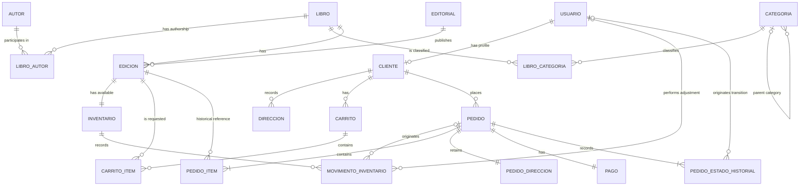
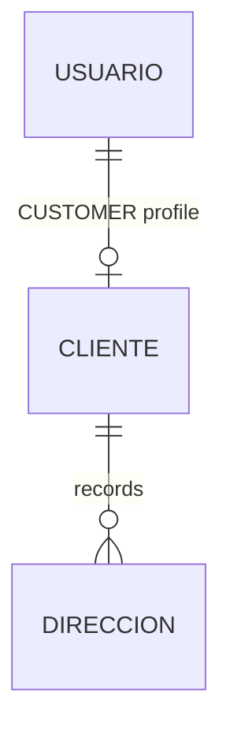
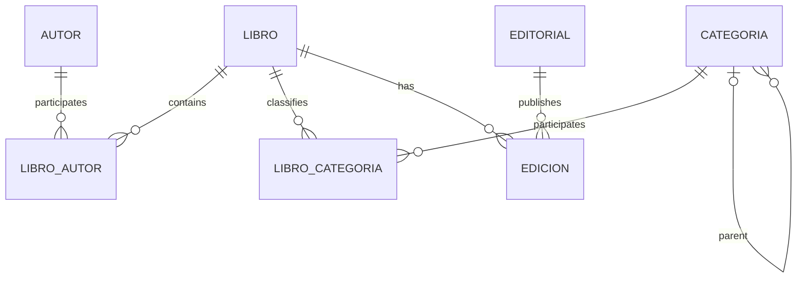
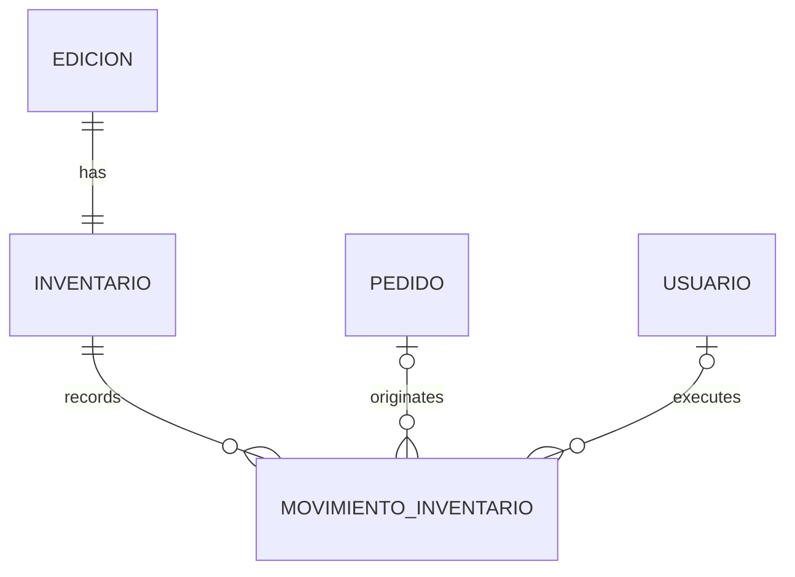
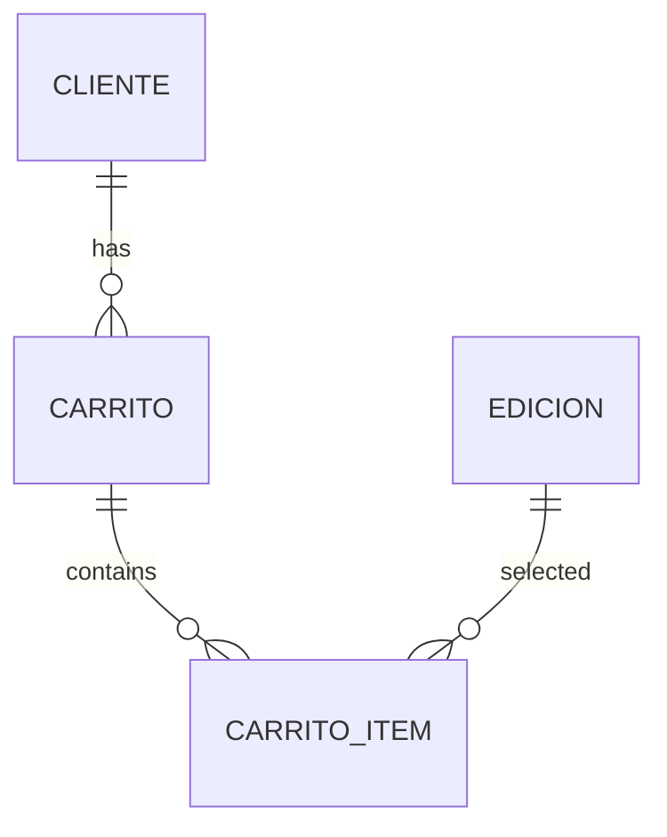
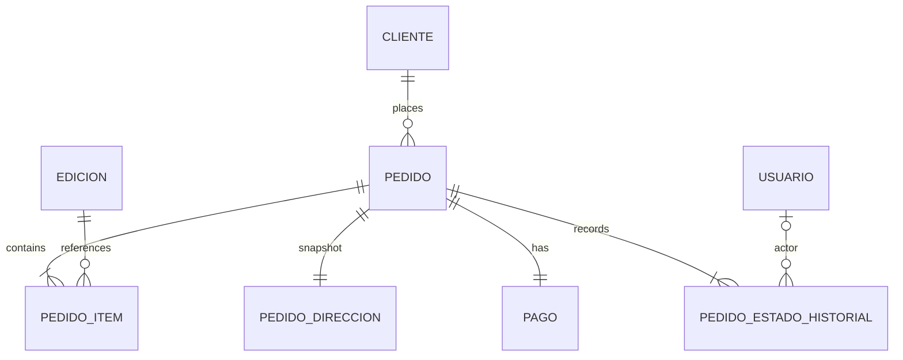

# PLIEGO — Logical ERD v1.0

**Document:** DERL-PLIEGO-001  
**Version:** 1.1  
**Status:** APPROVED BASELINE  
**Date:** 2026-09-23  
**Project:** PLIEGO  
**Document type:** Logical data model / Logical Entity–Relationship Diagram  
**Source document:** `docs/requirements/use-case-baseline-v1.0.md`  
**Scope:** PLIEGO v1 persistent domain  
**Next artifact:** Data Dictionary v1.0  

---

## 1. Purpose

This document defines the **PLIEGO v1 logical data model** derived from the *Use Case Baseline v1.0*. Its objective is to establish, before PostgreSQL physical design:

- persistent entities;
- logical identifiers;
- required attributes;
- relationships;
- cardinalities;
- optionality;
- alternate keys;
- existence dependencies;
- semantic constraints;
- controlled domains;
- normalization decisions;
- traceability to use cases and business rules.

The logical model is independent of physical details such as:

- specific PostgreSQL types;
- `VARCHAR` lengths;
- sequences;
- `IDENTITY`;
- indexes;
- final physical names;
- SQL syntax;
- Stored Procedures;
- Functions;
- Triggers;
- the exact locking strategy.

Those elements belong to later stages.

---

# 2. Methodological criteria

The logical ERD is derived through this sequence:

```text
Use Case Baseline
        ↓
Domain entities
        ↓
Relationships and cardinalities
        ↓
Identifiers and attributes
        ↓
Semantic constraints
        ↓
Normalization
        ↓
Logical ERD
```

The following principles apply:

1. **Traceability:** every persistent entity must be justified by at least one use case, requirement or business rule.
2. **No overmodeling:** entities corresponding to functionality outside PLIEGO v1 are not included.
3. **Conceptual separation:** a bibliographic work (`Libro`) and a commercial unit (`Edicion`) are distinct concepts.
4. **Immutable history:** Pedido, Pago, inventory movements and their snapshots preserve the historical commercial state.
5. **Single source of truth:** each mutable datum has a responsible entity.
6. **Normalization:** the transactional model targets third normal form, except for deliberate, justified historical denormalizations.
7. **Academic simplicity:** no entities, catalogs or abstractions are introduced whose complexity is not justified by the use cases.

---

# 3. Logical ERD scope

The model includes the 19 persistent entities authorized by the Use Case Baseline:

1. Usuario
2. Cliente
3. Direccion
4. Autor
5. Editorial
6. Categoria
7. Libro
8. LibroAutor
9. LibroCategoria
10. Edicion
11. Inventario
12. MovimientoInventario
13. Carrito
14. CarritoItem
15. Pedido
16. PedidoItem
17. PedidoDireccion
18. Pago
19. PedidoEstadoHistorial

No additional business entity is included.

---

# 4. Logical clarifications derived from the baseline

Two necessary clarifications are made when transforming use cases into a logical model to represent requirements already approved.

## 4.1 Traceability from MovimientoInventario to Pedido

Movements of types:

- `SALE`;
- `CANCELLATION`;

are generated by operations on a Pedido. To satisfy the traceability required by CU-SAL-01, CU-SAL-03 and RNF-012, `MovimientoInventario` may reference the `Pedido` that originated the movement.

This **does not create new functionality**; it materializes a relationship already implicit in the use cases.

Rule:

- `SALE` and `CANCELLATION` movements → originating Pedido required;
- administrative movements → originating Pedido absent.

## 4.2 Origin of PedidoEstadoHistorial

Pedido transitions may be produced:

- by a Usuario;
- automatically by the system within a business process.

Therefore, `PedidoEstadoHistorial` records:

- the transition origin (`USER` or `SYSTEM`);
- the acting Usuario when the origin is `USER`.

This correctly represents automatic payment-derived transitions without creating an artificial entity called “System”.

---

# 5. Logical model conventions

## 5.1 Attribute notation

In the specifications:

- **PK** = logical primary identifier.
- **FK** = logical reference to another entity.
- **AK** = alternate key or logical uniqueness.
- **M** = mandatory attribute.
- **O** = optional attribute.
- **D** = derivable attribute, not necessarily persisted.

The final decision on which derived attributes are stored will be made in the physical model, always preserving this baseline's rules.

## 5.2 Identifiers

Main entities use internal identifiers independent of commercial attributes.

Pure associative entities use identifiers composed of the entities they relate when this better expresses their logical identity.

## 5.3 Terminology

Names here are **logical names**, not final SQL names.

Example:

```text
PedidoEstadoHistorial
```

may subsequently be physically mapped to:

```text
pedido_estado_historial
```

without changing the logical model.

---

# 6. ERD overview



> The diagram shows structural cardinality. State-dependent constraints, such as “`ACTIVE` Libro must have at least one Autor”, are specified as invariants and must not be inferred exclusively from the graphical notation.

---

# 7. Identity and Customer submodel

## 7.1 Usuario

### Purpose

Represents an authenticatable identity within PLIEGO.

### Identifier

- **UsuarioId** — PK, M.

### Attributes

| Logical attribute | Role | Requiredness | Description |
|---|---|---|---|
| UsuarioId | PK | M | Internal identifier |
| EmailNormalizado | AK | M | Canonical email used for identity |
| PasswordHash | — | M | Password hash |
| Rol | domain | M | `CUSTOMER` or `ADMIN` |
| Estado | domain | M | `ACTIVE` or `BLOCKED` |
| FechaCreacion | — | M | Account creation |
| FechaActualizacion | — | M | Latest relevant modification |

### Keys

- PK: `UsuarioId`
- AK: `EmailNormalizado`

### Rules

- Normalized email is unique.
- PasswordHash never represents a plaintext password.
- Every `CUSTOMER` Usuario must have exactly one Cliente.
- An `ADMIN` Usuario does not require a Cliente.
- Usuario is not physically deleted in v1.

### Use cases

- CU-AUTH-01
- CU-AUTH-02
- CU-ADM-SEC-01

---

## 7.2 Cliente

### Purpose

Represents the commercial profile of a Usuario with role `CUSTOMER`.

### Identifier

- **ClienteId** — PK, M.

### Attributes

| Attribute | Role | Required |
|---|---|---|
| ClienteId | PK | M |
| UsuarioId | FK + AK | M |
| Nombres | — | M |
| Apellidos | — | M |
| Telefono | — | O |
| FechaCreacion | — | M |
| FechaActualizacion | — | M |

### Keys

- PK: `ClienteId`
- AK: `UsuarioId`

### Relationship

```text
Usuario 1 ───── 0..1 Cliente
Cliente ───── exactly 1 Usuario
```

Conditional constraint:

```text
Usuario.Rol = CUSTOMER  => exactly 1 Cliente
Usuario.Rol = ADMIN     => 0 Cliente in v1
```

### Use cases

- CU-AUTH-01
- CU-ADM-SEC-01
- CU-CUS-01

---

## 7.3 Direccion

### Purpose

Represents a reusable Cliente address for future checkouts.

### Identifier

- **DireccionId** — PK, M.

### Attributes

| Attribute | Role | Required |
|---|---|---|
| DireccionId | PK | M |
| ClienteId | FK | M |
| Alias | — | M |
| Destinatario | — | M |
| DireccionLinea1 | — | M |
| DireccionLinea2 | — | O |
| Ciudad | — | M |
| Provincia | — | M |
| PaisCodigo | — | M |
| CodigoPostal | — | O |
| Referencia | — | O |
| Telefono | — | M |
| EsPrincipal | — | M |
| FechaCreacion | — | M |
| FechaActualizacion | — | M |

### Cardinality

```text
Cliente 1 ───── 0..N Direccion
Direccion ───── exactly 1 Cliente
```

### Constraints

- At most one Direccion per Cliente may have `EsPrincipal = true`.
- A Cliente may exist without a primary Direccion.
- Direccion may be physically deleted.
- Pedido does not historically depend on Direccion; it uses PedidoDireccion.

### Use cases

- CU-CUS-02
- CU-SAL-01

---

# 8. Catalog submodel

## 8.1 Autor

### Purpose

Represents a person or authorial identity associable with Libros.

### Identifier

- **AutorId** — PK, M.

### Attributes

| Attribute | Role | Required |
|---|---|---|
| AutorId | PK | M |
| Nombre | — | M |
| Biografia | — | O |
| Estado | domain | M |
| FechaCreacion | — | M |
| FechaActualizacion | — | M |

### Rules

- `Nombre` is not unique.
- Status: `ACTIVE` / `INACTIVE`.
- An inactive Autor cannot be added to new authorship relationships.
- Existing relationships are retained.

---

## 8.2 Editorial

### Purpose

Represents the publisher responsible for an Edicion.

### Identifier

- **EditorialId** — PK, M.

### Attributes

| Attribute | Role | Required |
|---|---|---|
| EditorialId | PK | M |
| Nombre | — | M |
| Descripcion | — | O |
| Estado | domain | M |
| FechaCreacion | — | M |
| FechaActualizacion | — | M |

### Rules

- An inactive Editorial cannot be assigned to a new Edicion.
- Deactivation does not delete or historically invalidate existing Ediciones.
- The name is not declared a unique key in this baseline.

---

## 8.3 Categoria

### Purpose

Represents a thematic category or subcategory.

### Identifier

- **CategoriaId** — PK, M.

### Attributes

| Attribute | Role | Required |
|---|---|---|
| CategoriaId | PK | M |
| CategoriaPadreId | Self-referencing FK | O |
| Nombre | — | M |
| Slug | AK | M |
| Descripcion | — | O |
| Estado | domain | M |
| FechaCreacion | — | M |
| FechaActualizacion | — | M |

### Keys

- PK: `CategoriaId`
- AK: `Slug`

### Self-referencing cardinality

```text
CategoriaPadre 1 ───── 0..N Subcategorias
Subcategoria ───────── 0..1 CategoriaPadre
```

### Invariants

- `CategoriaPadreId = NULL` identifies a root category.
- A category whose `CategoriaPadreId` is not null is a subcategory.
- A subcategory cannot be the parent of another category.
- A category cannot be its own parent.
- Cycles cannot exist.
- Maximum depth: 2.
- `Slug` is globally unique (see §13).
- The depth constraint will be implemented in the Database API Contract (trigger or procedural validation that reads the parent).
- An inactive category cannot be assigned to new Libros.

---

## 8.4 Libro

### Purpose

Represents the bibliographic work independently of its commercial editions.

### Identifier

- **LibroId** — PK, M.

### Attributes

| Attribute | Role | Required |
|---|---|---|
| LibroId | PK | M |
| Titulo | — | M |
| Subtitulo | — | O |
| Sinopsis | — | O |
| Estado | domain | M |
| FechaCreacion | — | M |
| FechaActualizacion | — | M |

### Rules

- `Titulo` is not a unique key.
- A Libro may have multiple Ediciones.
- An `ACTIVE` Libro must have at least one Autor.
- An `ACTIVE` Libro must have at least one Categoria.
- There is no normal physical DELETE.

---

## 8.5 LibroAutor

### Purpose

Resolves the N:M relationship between Libro and Autor and preserves authorship order.

### Logical identifier

- **(LibroId, AutorId)** — composite PK.

### Attributes

| Attribute | Role | Required |
|---|---|---|
| LibroId | PK + FK | M |
| AutorId | PK + FK | M |
| OrdenAutoria | Partial AK | M |

### Constraints

- The same Autor cannot be repeated within the same Libro.
- `OrdenAutoria > 0`.
- Within a Libro, two authors cannot have the same `OrdenAutoria`.
- Reordering must run in a single transaction (the physical model will define the technique: deferred constraint or procedural swap); removing the last author from an `ACTIVE` Libro is rejected.

Logical alternate key:

```text
(LibroId, OrdenAutoria)
```

### Cardinality

```text
Libro 1 ───── 0..N LibroAutor
Autor 1 ───── 0..N LibroAutor
```

State invariant:

```text
Libro.Estado = ACTIVE => at least 1 LibroAutor
```

---

## 8.6 LibroCategoria

### Purpose

Resolves the N:M relationship between Libro and Categoria.

### Logical identifier

- **(LibroId, CategoriaId)** — composite PK.

### Attributes

| Attribute | Role | Required |
|---|---|---|
| LibroId | PK + FK | M |
| CategoriaId | PK + FK | M |

### Constraints

- The same Categoria cannot be repeated for the same Libro.
- An inactive Categoria cannot be added to a new relationship.

### Cardinality

```text
Libro 1 ───── 0..N LibroCategoria
Categoria 1 ─ 0..N LibroCategoria
```

Invariant:

```text
Libro.Estado = ACTIVE => at least 1 LibroCategoria
```

---

## 8.7 Edicion

### Purpose

Represents the physical commercial unit sellable in PLIEGO.

### Identifier

- **EdicionId** — PK, M.

### Attributes

| Attribute | Role | Required |
|---|---|---|
| EdicionId | PK | M |
| LibroId | FK | M |
| EditorialId | FK | M |
| SKU | AK | M |
| ISBN13 | Conditional AK | O |
| Idioma | — | M |
| Formato | domain | M |
| NumeroPaginas | — | M |
| FechaPublicacion | — | O |
| Precio | — | M |
| PortadaUrl | — | O |
| PortadaLicencia | — | Conditional O |
| PortadaFuenteUrl | — | Conditional O |
| PortadaAtribucion | — | O |
| Estado | domain | M |
| FechaCreacion | — | M |
| FechaActualizacion | — | M |

### Keys

- PK: `EdicionId`
- AK: `SKU`
- Conditional AK: `ISBN13` when present

### Relationships

```text
Libro 1 ───── 0..N Edicion
Edicion ───── exactly 1 Libro

Editorial 1 ─ 0..N Edicion
Edicion ───── exactly 1 Editorial
```

### Invariants

- Precio > 0.
- NumeroPaginas > 0.
- ISBN13, when present, must be valid and unique.
- Formato: `PAPERBACK` or `HARDCOVER`.
- An Edicion is commercially publishable only if:
  - `Edicion.Estado = ACTIVE`; and
  - `Libro.Estado = ACTIVE`.
- `LibroId` and `SKU` are stable after creation.
- If `PortadaUrl` exists, an identifiable license and source must exist.
- Edicion does not store stock.

---

# 9. Inventory submodel

## 9.1 Inventario

### Purpose

Constitutes the single source of truth for an Edicion's stock.

### Logical identifier

Since PLIEGO v1 establishes a mandatory 1:1 relationship, Inventario is identified by:

- **EdicionId** — PK + FK, M.

This is a logical identification decision. The physical model may retain this shared key or introduce a technical identifier without changing the 1:1 cardinality.

### Attributes

| Attribute | Role | Required |
|---|---|---|
| EdicionId | PK + FK | M |
| StockActual | — | M |
| StockMinimo | — | M |
| FechaActualizacion | — | M |

### Cardinality

```text
Edicion 1 ───── 1 Inventario
```

Total participation at both ends once Edicion creation is committed.

### Invariants

- `StockActual >= 0`.
- `StockMinimo >= 0`.
- Low stock can be derived as:

```text
StockMinimo > 0 AND StockActual <= StockMinimo
```

(`StockMinimo = 0` means "no threshold".)

- Creation of Edicion and its Inventario is atomic.

---

## 9.2 MovimientoInventario

### Purpose

Immutably records every committed stock variation.

### Identifier

- **MovimientoInventarioId** — PK, M.

### Attributes

| Attribute | Role | Required |
|---|---|---|
| MovimientoInventarioId | PK | M |
| EdicionId | FK to Inventario | M |
| PedidoId | FK | Conditional O |
| UsuarioActorId | FK | Conditional O |
| Tipo | domain | M |
| Cantidad | — | M |
| StockAnterior | — | M |
| StockPosterior | — | M |
| Motivo | — | Conditional O |
| Fecha | — | M |

### Relationships

```text
Inventario 1 ───── 0..N MovimientoInventario

Pedido 1 ───────── 0..N MovimientoInventario
MovimientoInventario ── 0..1 Pedido

Usuario 1 ──────── 0..N MovimientoInventario
MovimientoInventario ── 0..1 Usuario
```

### Tipo domain

- `ENTRY`
- `ADJUSTMENT_IN`
- `ADJUSTMENT_OUT`
- `SALE`
- `CANCELLATION`

### Conditional constraints

#### ENTRY / ADJUSTMENT_IN / ADJUSTMENT_OUT

- `UsuarioActorId` required (ADMIN).
- `PedidoId` absent.
- `Motivo` required for all three administrative types.
- These are administrative operations.

#### SALE

- `PedidoId` required.
- `UsuarioActorId` absent (automatic movement).
- Can only originate from a committed checkout.
- `(PedidoId, EdicionId, Tipo)` unique: at most one `SALE` per Pedido and Edicion.

#### CANCELLATION

- `PedidoId` required.
- `UsuarioActorId` absent (automatic movement).
- May only restore stock from a previously committed and subsequently cancelled Pedido.
- Requires a previous `SALE` for the same `(PedidoId, EdicionId)`.
- `(PedidoId, EdicionId, Tipo)` unique: at most one `CANCELLATION` per Pedido and Edicion.

### Arithmetic invariants

For `Cantidad > 0`:

```text
ENTRY:
StockPosterior = StockAnterior + Cantidad

ADJUSTMENT_IN:
StockPosterior = StockAnterior + Cantidad

ADJUSTMENT_OUT:
StockPosterior = StockAnterior - Cantidad

SALE:
StockPosterior = StockAnterior - Cantidad

CANCELLATION:
StockPosterior = StockAnterior + Cantidad
```

Always:

```text
StockAnterior >= 0
StockPosterior >= 0
```

### Immutability

MovimientoInventario is neither updated nor deleted after commitment.

---

# 10. Cart submodel

## 10.1 Carrito

### Purpose

Temporarily groups Ediciones that a Cliente wishes to buy.

### Identifier

- **CarritoId** — PK, M.

### Attributes

| Attribute | Role | Required |
|---|---|---|
| CarritoId | PK | M |
| ClienteId | FK | M |
| Estado | domain | M |
| FechaCreacion | — | M |
| FechaActualizacion | — | M |

### Cardinality

```text
Cliente 1 ───── 0..N Carrito
Carrito ─────── exactly 1 Cliente
```

### Estado domain

- `ACTIVE`
- `CHECKED_OUT`

### Invariants

- A Cliente may have multiple historical carts.
- At most one may be `ACTIVE`.
- `CHECKED_OUT` is final in v1 (DD-COR-003: `CANCELLED` outside PLIEGO v1).
- An empty cart is valid.

---

## 10.2 CarritoItem

### Purpose

Represents an Edicion and its quantity within a Carrito.

### Identifier

- **CarritoItemId** — PK, M.

A dedicated identifier is retained because the use cases allow modifying/deleting a specific item.

### Attributes

| Attribute | Role | Required |
|---|---|---|
| CarritoItemId | PK | M |
| CarritoId | FK | M |
| EdicionId | FK | M |
| Cantidad | — | M |
| FechaCreacion | — | M |
| FechaActualizacion | — | M |

### Alternate key

```text
(CarritoId, EdicionId)
```

must be unique.

### Cardinality

```text
Carrito 1 ───── 0..N CarritoItem
Edicion 1 ───── 0..N CarritoItem
```

### Invariants

- `Cantidad > 0`.
- An Edicion appears at most once in the same Carrito.
- During CU-CART-02 and CU-CART-03, the requested quantity cannot exceed current stock.
- This validation **does not constitute a reservation**.
- Price is not stored as an authority in CarritoItem; it is obtained from Edicion while the cart remains active.

---

# 11. Sales submodel

## 11.1 Pedido

### Purpose

Represents a persisted commercial operation generated by checkout.

### Identifier

- **PedidoId** — PK, M.

### Attributes

| Attribute | Role | Required |
|---|---|---|
| PedidoId | PK | M |
| ClienteId | FK | M |
| Estado | domain | M |
| Subtotal | — | M |
| Total | — | M |
| FechaCreacion | — | M |
| FechaActualizacion | — | M |

### Cardinality

```text
Cliente 1 ───── 0..N Pedido
Pedido ──────── exactly 1 Cliente
```

### Estado domain

- `PENDING_PAYMENT`
- `CONFIRMED`
- `PREPARING`
- `SHIPPED`
- `DELIVERED`
- `CANCELLED`

### Invariants

- Every Pedido committed as a checkout transaction has:
  - 1..N PedidoItem;
  - exactly 1 PedidoDireccion;
  - exactly 1 Pago;
  - at least 1 PedidoEstadoHistorial.
- `Subtotal > 0`.
- `Total > 0`.
- En PLIEGO v1:

```text
Total = Subtotal
```

- System operating currency: USD.
- Pedido is never physically deleted.
- Pedido does not need an FK to Carrito in v1.

---

## 11.2 PedidoItem

### Purpose

Represents each purchased Edicion and preserves the commercial snapshot at purchase time.

### Identifier

- **PedidoItemId** — PK, M.

### Attributes

| Attribute | Role | Required |
|---|---|---|
| PedidoItemId | PK | M |
| PedidoId | FK | M |
| EdicionId | Historical FK | M |
| SKU_Snapshot | snapshot | M |
| ISBN_Snapshot | snapshot | O |
| Titulo_Snapshot | snapshot | M |
| Autores_Snapshot | snapshot | M |
| Editorial_Snapshot | snapshot | M |
| Formato_Snapshot | snapshot | M |
| Idioma_Snapshot | snapshot | M |
| PrecioUnitario | snapshot | M |
| Cantidad | — | M |
| Subtotal | — | M |

### Cardinality

```text
Pedido 1 ───── 1..N PedidoItem
Edicion 1 ──── 0..N PedidoItem
```

### Invariants

- `Cantidad > 0`.
- `PrecioUnitario > 0`.
- `Subtotal = PrecioUnitario × Cantidad`.
- `(PedidoId, EdicionId)` unique: an Edicion appears at most once per Pedido.
- Snapshots are immutable after checkout.
- Changes to Edicion, Libro, Autor or Editorial do not modify PedidoItem.

### Deliberate denormalization

`Autores_Snapshot`, `Titulo_Snapshot`, `Editorial_Snapshot` and other snapshots intentionally duplicate catalog information.

Justification:

- historical preservation;
- independence from subsequent changes;
- they are not the catalog's source of truth;
- they are not used to update master entities.

This denormalization is expressly accepted by the baseline.

---

## 11.3 PedidoDireccion

### Purpose

Retains the address used at checkout time.

### Logical identifier

Given the 1:1 relationship:

- **PedidoId** — PK + FK, M.

### Attributes

| Attribute | Role | Required |
|---|---|---|
| PedidoId | PK + FK | M |
| Destinatario | snapshot | M |
| DireccionLinea1 | snapshot | M |
| DireccionLinea2 | snapshot | O |
| Ciudad | snapshot | M |
| Provincia | snapshot | M |
| PaisCodigo | snapshot | M |
| CodigoPostal | snapshot | O |
| Referencia | snapshot | O |
| Telefono | snapshot | M |

### Cardinality

```text
Pedido 1 ───── 1 PedidoDireccion
```

### Fundamental rule

There is no historical FK from PedidoDireccion to Direccion.

The Cliente's Direccion is only the source used to generate the snapshot during checkout.

This ensures that:

```text
modifying/deleting Direccion
```

does not modify:

```text
PedidoDireccion
```

---

## 11.4 Pago

### Purpose

Represents the academic payment attempt associated with Pedido.

### Identifier

- **PagoId** — PK, M.

### Attributes

| Attribute | Role | Required |
|---|---|---|
| PagoId | PK | M |
| PedidoId | FK + AK | M |
| Metodo | domain | M |
| Estado | domain | M |
| Monto | — | M |
| Referencia | — | O |
| DetalleResultado | — | O |
| FechaCreacion | — | M |
| FechaActualizacion | — | M |

### Alternate key

`PedidoId` is unique in Pago to represent one Pago per Pedido in v1. `Referencia`, when present, is globally unique (DD-COR-011).

```text
Pedido 1 ───── 1 Pago
```

in PLIEGO v1.

### Method

- `CARD`
- `TRANSFER`

### Status

- `PENDING`
- `APPROVED`
- `REJECTED`
- `REFUNDED`

### Invariants

- `Monto = Pedido.Total`.
- `Monto > 0`.
- `CONFIRMED` Pedido requires `APPROVED` Pago.
- `APPROVED` can subsequently transition only to `REFUNDED`.
- CVV is not persisted.
- The complete card number is not persisted.
- Pago is not physically deleted.

---

## 11.5 PedidoEstadoHistorial

### Purpose

Maintains complete traceability of Pedido state transitions.

### Identifier

- **PedidoEstadoHistorialId** — PK, M.

### Attributes

| Attribute | Role | Required |
|---|---|---|
| PedidoEstadoHistorialId | PK | M |
| PedidoId | FK | M |
| UsuarioActorId | FK | Conditional O |
| Origen | domain | M |
| EstadoAnterior | domain | O |
| EstadoNuevo | domain | M |
| Fecha | — | M |

### Cardinality

```text
Pedido 1 ───── 1..N PedidoEstadoHistorial
Usuario 1 ──── 0..N PedidoEstadoHistorial
Historial ──── 0..1 Usuario
```

### Origen domain

- `USER`
- `SYSTEM`

### Constraints

- The first record may have no `EstadoAnterior`.
- If `Origen = USER`, `UsuarioActorId` is required.
- If `Origen = SYSTEM`, `UsuarioActorId` may be absent.
- Each change must represent an allowed transition.
- History is immutable.
- Every Pedido must have at least its initial-state record.

---

# 12. Consolidated relationships and cardinalities

| Relationship | Cardinality | Participation / rule |
|---|---|---|
| Usuario — Cliente | 1 : 0..1 | CUSTOMER requires 1 Cliente |
| Cliente — Direccion | 1 : 0..N | Direccion belongs to 1 Cliente |
| Libro — Autor | N : M | through LibroAutor |
| Libro — Categoria | N : M | through LibroCategoria |
| Categoria — Categoria | 1 : 0..N | at most two levels |
| Libro — Edicion | 1 : 0..N | Edicion belongs to 1 Libro |
| Editorial — Edicion | 1 : 0..N | Edicion belongs to 1 Editorial |
| Edicion — Inventario | 1 : 1 | obligatoria |
| Inventario — MovimientoInventario | 1 : 0..N | every movement belongs to 1 Inventario |
| Pedido — MovimientoInventario | 1 : 0..N | a movement may belong to 0..1 Pedido |
| Usuario — MovimientoInventario | 1 : 0..N | a movement may have 0..1 actor |
| Cliente — Carrito | 1 : 0..N | at most one ACTIVE |
| Carrito — CarritoItem | 1 : 0..N | item belongs to 1 cart |
| Edicion — CarritoItem | 1 : 0..N | unique Carrito/Edicion pair |
| Cliente — Pedido | 1 : 0..N | Pedido belongs to 1 Cliente |
| Pedido — PedidoItem | 1 : 1..N | mandatory participation |
| Edicion — PedidoItem | 1 : 0..N | historical reference |
| Pedido — PedidoDireccion | 1 : 1 | required snapshot |
| Pedido — Pago | 1 : 1 | PLIEGO v1 |
| Pedido — PedidoEstadoHistorial | 1 : 1..N | required history |
| Usuario — PedidoEstadoHistorial | 1 : 0..N | record may have 0..1 Usuario |

---

# 13. Logical keys and uniqueness

| Entity | Logical PK | Alternate keys / uniqueness |
|---|---|---|
| Usuario | UsuarioId | EmailNormalizado |
| Cliente | ClienteId | UsuarioId |
| Direccion | DireccionId | — |
| Autor | AutorId | — |
| Editorial | EditorialId | — |
| Categoria | CategoriaId | Slug |
| Libro | LibroId | — |
| LibroAutor | LibroId + AutorId | LibroId + OrdenAutoria |
| LibroCategoria | LibroId + CategoriaId | — |
| Edicion | EdicionId | SKU; ISBN13 when present |
| Inventario | EdicionId | — |
| MovimientoInventario | MovimientoInventarioId | PedidoId + EdicionId + Tipo for SALE/CANCELLATION |
| Carrito | CarritoId | at most one ACTIVE per Cliente |
| CarritoItem | CarritoItemId | CarritoId + EdicionId |
| Pedido | PedidoId | — |
| PedidoItem | PedidoItemId | PedidoId + EdicionId |
| PedidoDireccion | PedidoId | — |
| Pago | PagoId | PedidoId; Referencia when present |
| PedidoEstadoHistorial | PedidoEstadoHistorialId | — |

---

# 14. Controlled domains

These concepts are **logical domains**, not separate tables in v1.

Creating catalog tables for them would add complexity without a current functional need.

## 14.1 UsuarioRol

```text
CUSTOMER
ADMIN
```

## 14.2 UsuarioEstado

```text
ACTIVE
BLOCKED
```

## 14.3 EstadoCatalogo

Applies to:

- Autor;
- Editorial;
- Categoria;
- Libro;
- Edicion.

```text
ACTIVE
INACTIVE
```

## 14.4 FormatoEdicion

```text
PAPERBACK
HARDCOVER
```

## 14.5 TipoMovimientoInventario

```text
ENTRY
ADJUSTMENT_IN
ADJUSTMENT_OUT
SALE
CANCELLATION
```

## 14.6 EstadoCarrito

```text
ACTIVE
CHECKED_OUT
```

`CANCELLED` is outside PLIEGO v1 (DD-COR-003): no use case produces it.

## 14.7 EstadoPedido

```text
PENDING_PAYMENT
CONFIRMED
PREPARING
SHIPPED
DELIVERED
CANCELLED
```

## 14.8 MetodoPago

```text
CARD
TRANSFER
```

## 14.9 EstadoPago

```text
PENDING
APPROVED
REJECTED
REFUNDED
```

## 14.10 OrigenTransicionPedido

```text
USER
SYSTEM
```

## 14.11 Currency

PLIEGO v1 operates only in:

```text
USD
```

As this is a global constant for the version, no Moneda entity is required in ERD v1.

---

# 15. Cross-entity constraints that the ERD alone does not express

These rules must subsequently be preserved through the Database API, constraints and/or triggers as appropriate.

## 15.1 Usuario/Cliente

```text
Usuario.Rol = CUSTOMER
=> exactly one Cliente must exist
```

## 15.2 Primary address

```text
per Cliente:
COUNT(Direccion WHERE EsPrincipal = true) <= 1
```

## 15.3 Minimum authorship

```text
Libro.Estado = ACTIVE
=> COUNT(LibroAutor) >= 1
```

## 15.4 Minimum category membership

```text
Libro.Estado = ACTIVE
=> COUNT(LibroCategoria) >= 1
```

## 15.5 Commercial publication

```text
Publishable Edicion
<=>
Edicion.Estado = ACTIVE
AND Libro.Estado = ACTIVE
```

Stock determines availability, not visibility.

## 15.6 Single active Carrito

```text
per Cliente:
COUNT(Carrito WHERE Estado = ACTIVE) <= 1
```

## 15.7 Availability in cart

When adding/modifying:

```text
CarritoItem.Cantidad <= Inventario.StockActual
```

This condition is not permanent because the cart does not reserve stock.

## 15.8 Checkout

At the transactional instant of checkout:

```text
Libro ACTIVE
Edicion ACTIVE
StockActual >= Cantidad
Direccion belongs to Cliente
Carrito belongs to Cliente
Carrito ACTIVE
Carrito not empty
```

## 15.9 Totals

For each PedidoItem:

```text
Subtotal = PrecioUnitario × Cantidad
```

For Pedido:

```text
Subtotal = SUM(PedidoItem.Subtotal)
Total = Subtotal
```

## 15.10 Pago

```text
Pago.Monto = Pedido.Total
```

y:

```text
Pedido.Estado = CONFIRMED
=> Pago.Estado = APPROVED
```

## 15.11 Cancellation

Cancelled `CONFIRMED` or `PREPARING` Pedido:

- restores inventory;
- generates `CANCELLATION`;
- `APPROVED` Pago transitions to `REFUNDED`;
- creates Pedido history;
- everything occurs atomically.

---

# 16. State machines referenced by the model

## 16.1 Usuario

```text
ACTIVE <-> BLOCKED
```

## 16.2 Catalog entities

```text
ACTIVE <-> INACTIVE
```

Applies to:

- Autor;
- Editorial;
- Categoria;
- Libro;
- Edicion.

## 16.3 Carrito

```text
ACTIVE -> CHECKED_OUT
```

## 16.4 Pedido

```text
PENDING_PAYMENT
      │
      ├──> CONFIRMED -> PREPARING -> SHIPPED -> DELIVERED
      │         │           │
      │         └──────────> CANCELLED
      │                     ▲
      └-------------------->┘
```

`PENDING_PAYMENT` is transient and intra-transactional within checkout (see baseline v1.1): no post-commit observable Pedido remains in this state. Each committed checkout persists the initial record (`NULL -> PENDING_PAYMENT`, `SYSTEM`) and the corresponding terminal record.

## 16.5 Pago

```text
PENDING -> APPROVED -> REFUNDED
       \-> REJECTED
```

State machines form part of the model's semantics and must be implemented in PostgreSQL.

---

# 17. Existence dependencies

## 17.1 Strong dependencies

The following entities have no independent meaning without their owning entity:

### LibroAutor

Depends on:

- Libro;
- Autor.

### LibroCategoria

Depends on:

- Libro;
- Categoria.

### Inventario

Depends on Edicion.

### CarritoItem

Depends on:

- Carrito;
- Edicion.

### PedidoItem

Depends on Pedido, although it retains a historical reference to Edicion.

### PedidoDireccion

Depends entirely on Pedido.

### Pago

Depends on Pedido.

### PedidoEstadoHistorial

Depends on Pedido.

### MovimientoInventario

Depends on Inventario.

## 17.2 Historical independence

Although some entities structurally depend on others, deletion policies prevent historical loss.

In particular:

- Edicion is not physically deleted;
- Pedido is not deleted;
- MovimientoInventario is not deleted;
- Pago is not deleted.

---

# 18. Normalization analysis

## 18.1 First Normal Form — 1FN

Operational entities retain scalar attributes, and repeating groups are represented by separate entities.

Examples:

- multiple authors → LibroAutor;
- multiple categories → LibroCategoria;
- multiple items → CarritoItem / PedidoItem;
- multiple addresses → Direccion;
- multiple movements → MovimientoInventario;
- multiple historical states → PedidoEstadoHistorial.

### Deliberate historical exception

`Autores_Snapshot` in PedidoItem represents a historical textual projection.

It is not used as a normalized relationship or as the catalog's source of truth.

Its purpose is to preserve the purchase representation exactly.

---

## 18.2 Second Normal Form — 2FN

Associative entities with composite keys contain no attributes that depend on only part of the key.

### LibroAutor

`OrdenAutoria` depends on the Autor's participation in the Libro, not exclusively on Libro or exclusively on Autor.

### LibroCategoria

Contains no additional attributes.

There are therefore no relevant partial dependencies.

---

## 18.3 Third Normal Form — 3FN

Master data is separated according to its functional dependency.

Examples:

- Editorial data is not stored in Edicion except for the reference;
- Autor data is not stored in Libro;
- stock is not stored in Edicion;
- Cliente data is not stored in Pedido;
- reusable Direccion is not incorporated directly into Cliente;
- payment state is not duplicated in Pedido.

### Accepted denormalizations

Two structures are deliberately denormalized:

1. PedidoItem;
2. PedidoDireccion.

Both serve a historical purpose and are immutable.

Duplication is intentional and prevents master-data changes from rewriting commercial history.

---

# 19. Analysis of avoided anomalies

## 19.1 Separate Libro and Edicion

Avoids:

- repeating title/authors for each ISBN;
- associating a single price with a work that has multiple editions;
- associating a single publisher with the entire work;
- confusing physical stock with an intellectual work.

## 19.2 Inventario separate from Edicion

Avoids:

- mixing bibliographic information with operational state;
- stock updates on catalog data;
- future duplication if inventory evolves.

## 19.3 Autor N:M

Avoids:

```text
autor1, autor2, autor3
```

or a textual list as a source of truth.

## 19.4 Categoria N:M

Avoids duplicating Libro to classify it in multiple categories.

## 19.5 Pedido snapshots

Prevent catalog modifications from factually changing a historical purchase.

## 19.6 MovimientoInventario

Avoids losing the reason why `StockActual` changed.

## 19.7 PedidoEstadoHistorial

Avoids knowing only the current state without explaining how it was reached.

---

# 20. Logical referential integrity policy

The physical `ON DELETE` policy will be defined later, but the logical model establishes:

| Relationship | Logical policy |
|---|---|
| Usuario → Cliente | Do not delete Usuario |
| Cliente → Direccion | Direccion may be explicitly deleted |
| Autor → LibroAutor | Autor is not physically deleted |
| Categoria → LibroCategoria | Categoria is not physically deleted |
| Libro → Edicion | Libro is not physically deleted |
| Editorial → Edicion | Editorial is not physically deleted |
| Edicion → Inventario | Edicion is not physically deleted |
| Inventario → MovimientoInventario | Do not delete Inventario with history |
| Cliente → Carrito | Cliente is not physically deleted |
| Carrito → CarritoItem | Items may be deleted while the cart is editable |
| Cliente → Pedido | Cliente is not physically deleted |
| Pedido → PedidoItem | Never delete Pedido/Items |
| Pedido → PedidoDireccion | Never delete |
| Pedido → Pago | Never delete |
| Pedido → Historial | Never delete |
| Edicion → PedidoItem | Edicion is not physically deleted |

No destructive cascades will be defined over commercial history.

---

# 21. Entity → functional source matrix

| Entity | Main use cases | Main rules |
|---|---|---|
| Usuario | AUTH-01, AUTH-02, ADM-SEC-01 | BR-SEC-* |
| Cliente | AUTH-01, CUS-01 | BR-CUS-001 |
| Direccion | CUS-02, SAL-01 | BR-CUS-002/003 |
| Autor | ADM-CAT-01/04, CAT-01/02 | BR-CAT-002/011/015 |
| Editorial | ADM-CAT-02/05 | BR-CAT-005 |
| Categoria | ADM-CAT-03/04 | BR-CAT-003/012/013/014 |
| Libro | ADM-CAT-04, CAT-01/02 | BR-CAT-001/002/003/010 |
| LibroAutor | ADM-CAT-04 | BR-CAT-011/015 |
| LibroCategoria | ADM-CAT-04 | BR-CAT-012 |
| Edicion | ADM-CAT-05, CART-02, SAL-01 | BR-CAT-004..010 |
| Inventario | INV-01/02/03, CART-02/03, SAL-01/03 | BR-INV-* |
| MovimientoInventario | INV-02, SAL-01/03 | BR-INV-004..007 |
| Carrito | CART-01..04, SAL-01 | BR-CART-001/005/006 |
| CarritoItem | CART-01..04, SAL-01 | BR-CART-002/003 |
| Pedido | SAL-01/02/03, ADM-SAL-01 | BR-ORD-* |
| PedidoItem | SAL-01/02/03 | BR-ORD-002/005/007 |
| PedidoDireccion | SAL-01/02 | BR-ORD-003/006 |
| Pago | PAY-01, SAL-01/03 | BR-PAY-* |
| PedidoEstadoHistorial | SAL-01/02/03, ADM-SAL-01 | BR-ORD-008/009 |

---

# 22. Entity → module ownership matrix

This division serves as a subsequent architectural boundary without turning the system into microservices.

| Logical module | Entidades |
|---|---|
| Identity | Usuario |
| Customer | Cliente, Direccion |
| Catalog | Autor, Editorial, Categoria, Libro, LibroAutor, LibroCategoria, Edicion |
| Inventory | Inventario, MovimientoInventario |
| Cart | Carrito, CarritoItem |
| Sales | Pedido, PedidoItem, PedidoDireccion, PedidoEstadoHistorial |
| Payment | Pago |

Modules are organizational boundaries of the monolith, not separate databases.

---

# 23. Derived data that does not require its own entity

The following concepts are calculated and do not justify additional tables.

## Availability

```text
Disponible =
Libro ACTIVE
AND Edicion ACTIVE
AND Inventario.StockActual > 0
```

## Low stock

```text
BajoStock =
Inventario.StockMinimo > 0
AND Inventario.StockActual <= Inventario.StockMinimo
```

## Cart subtotal

```text
SUM(CarritoItem.Cantidad × current Edicion.Precio)
```

## PedidoItem subtotal

```text
Cantidad × PrecioUnitario
```

## Pedido total v1

```text
SUM(PedidoItem.Subtotal)
```

## Cliente full name

Can be derived from:

```text
Nombres + Apellidos
```

A mutable copy does not need to be stored within Cliente.

---

# 24. Data that must not be duplicated

To avoid inconsistencies, the logical model prohibits the following duplications as active sources of truth:

- `Edicion.Stock`;
- `Libro.AutorTexto`;
- `Libro.CategoriaId`;
- `Pedido.EstadoPago`;
- `Cliente.DireccionActual`;
- `CarritoItem.PrecioFijo`;
- `Pedido.DireccionId` as historical reconstruction;
- `Edicion.NombreEditorial`;
- `Libro.EditorialId`;
- `Inventario.TituloLibro`.

Queries must resolve these relationships from their responsible entities.

The only exception is the **explicitly defined historical snapshots**.

---

# 25. Temporal consistency rules

## 25.1 Catalog

Modifying:

- Libro;
- Autor;
- Editorial;
- Edicion;

affects current queries, not historical orders.

## 25.2 Carrito

The cart represents current intent.

Therefore:

- price may change;
- stock may change;
- availability may change;

between addition and checkout.

## 25.3 Pedido

Pedido represents a historical fact.

Therefore:

- price does not change;
- snapshots do not change;
- the address snapshot does not change;
- items do not change after committed creation.

## 25.4 Inventario

`StockActual` represents the present state.

`MovimientoInventario` represents immutable history.

---

# 26. ERD by functional area

## 26.1 Identity and Customer



## 26.2 Catalog



## 26.3 Inventario



## 26.4 Carrito



## 26.5 Sales and Payment



---

# 27. Validation against critical use cases

## CU-CART-02 — Add edition

The model provides:

- Cliente;
- Carrito;
- CarritoItem;
- Edicion;
- Libro;
- Inventario.

Can validate:

- ownership;
- state;
- quantity;
- availability;
- Edicion/Carrito uniqueness.

**Result:** covered.

## CU-SAL-01 — Checkout

The model provides:

- Carrito/CarritoItem;
- Libro/Edicion;
- Inventario;
- Pedido/PedidoItem;
- PedidoDireccion;
- Pago;
- MovimientoInventario;
- PedidoEstadoHistorial.

Can persist:

- current prices converted to snapshots;
- address snapshot;
- payment;
- stock;
- movements;
- states.

**Result:** covered.

## CU-SAL-03 — Cancellation

The model can identify:

- Pedido;
- items;
- purchased quantity;
- Pago;
- Inventario;
- `CANCELLATION` movement;
- history.

**Result:** covered.

## CU-ADM-SAL-01 — Logistics management

The model retains:

- current Pedido state;
- history;
- transition actor.

**Result:** covered.

---

# 28. ERD completeness validation

| Validation question | Result |
|---|---|
| Does every use case requiring persistence have entities? | Yes |
| Is every entity justified by a use case/rule? | Yes |
| Are Libro and Edicion separate? | Yes |
| Is multiple authorship resolved? | Yes |
| Is multiple classification resolved? | Yes |
| Is the category hierarchy represented? | Yes |
| Does Inventario have a single source of truth? | Yes |
| Are stock changes traceable? | Yes |
| Can sale/cancellation movements be linked to Pedido? | Yes |
| Does Carrito support multiple items without duplicating Edicion? | Yes |
| Can checkout be persisted atomically? | Yes |
| Does Pedido retain snapshots? | Yes |
| Does modifying an address affect previous orders? | No |
| Does modifying the catalog affect previous orders? | No |
| Does Pago have a 1:1 relationship in v1? | Yes |
| Are Pedido states traceable? | Yes |
| Can automatic and human history actions be distinguished? | Yes |
| Were out-of-scope entities introduced? | No |
| Does the ERD depend on the frontend? | No |
| Does the ERD depend on JPA/Hibernate? | No |
| Are there critical TBDs? | No |

---

# 29. Controlled risks and deferred decisions

The following items are intentionally deferred to the physical model or Database API Contract and **do not constitute ERD ambiguity**:

1. Exact type of each identifier.
2. Maximum string length.
3. Use of `ENUM`, `CHECK` or PostgreSQL domains.
4. ID generation strategy.
5. Indexes.
6. Partial indexes for `ACTIVE` Carrito.
7. Physical constraint for a single primary Direccion.
8. SQL strategy for two-level categories.
9. Exact checkout locking.
10. Stored Procedure signatures.
11. SQLSTATE/error codes.
12. Serialization format for `Autores_Snapshot`.
13. Physical timestamp convention.
14. HTTP authentication strategy.
15. OpenAPI.

These decisions will be resolved in subsequent artifacts without changing the entities and relationships defined here.

---

# 30. Stability criterion

The logical ERD v1.0 may be considered stable when:

- all entities are justified;
- all critical relationships have cardinalities;
- relevant natural/alternate keys are identified;
- there are no unresolved N:M relationships;
- states and historical dependencies can be represented;
- no operational datum has more than one source of truth;
- normalization exceptions are justified;
- critical use cases can conceptually execute on the model;
- there are no critical `TBD` decisions.

This document meets these criteria and remains an **APPROVED BASELINE**.

---

# 31. Next stage

Once this logical ERD is approved, the sequence will be:

```text
Logical ERD v1.0
        ↓
Data Dictionary v1.0
        ↓
Database API Contract v1.0
        ↓
PostgreSQL physical model
        ↓
Flyway Baseline
        ↓
SP / Functions / Triggers
        ↓
REST API Contract
        ↓
Implementation
```

The **Data Dictionary** must establish for each attribute:

- semantic definition;
- requiredness;
- domain;
- conceptual length/range;
- origin;
- validation rules;
- sensitivity;
- mutability;
- valid and invalid examples.

Only then will specific PostgreSQL types be selected.

---

# 32. Document history

| Version | Date | Status | Description |
|---|---|---|---|
| 1.0 | 2026-09-23 | BASELINE CANDIDATE | First formal logical ERD derived from Use Case Baseline v1.0. Defines 19 entities, logical keys, relationships, cardinalities, constraints, domains and normalization. |
| 1.1 | 2026-09-23 | BASELINE | Architectural review: feeds back DD-COR-001/002/004/005/007/008/011 (country, language, > 0, Pedido/Edicion AK, movement AK, reason and actor, unique reference), removes Carrito.CANCELLED, establishes low stock with a threshold and transient PENDING_PAYMENT. |

---

# 33. Project references

- `docs/requirements/use-case-baseline-v1.0.md`
- ISO/IEC/IEEE 29148:2018 — Requirements Engineering.
- OMG UML 2.5.1 — conceptual modeling reference.
- PLIEGO Architecture Baseline: Java 25 + Spring Boot + PostgreSQL + Flyway; PostgreSQL-centered business logic; no ORM; decoupled frontend implemented later.
